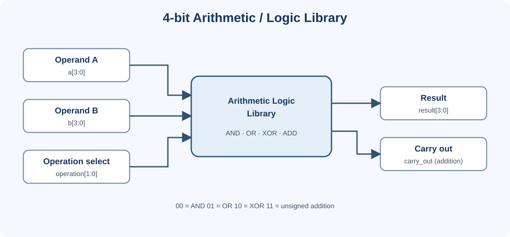
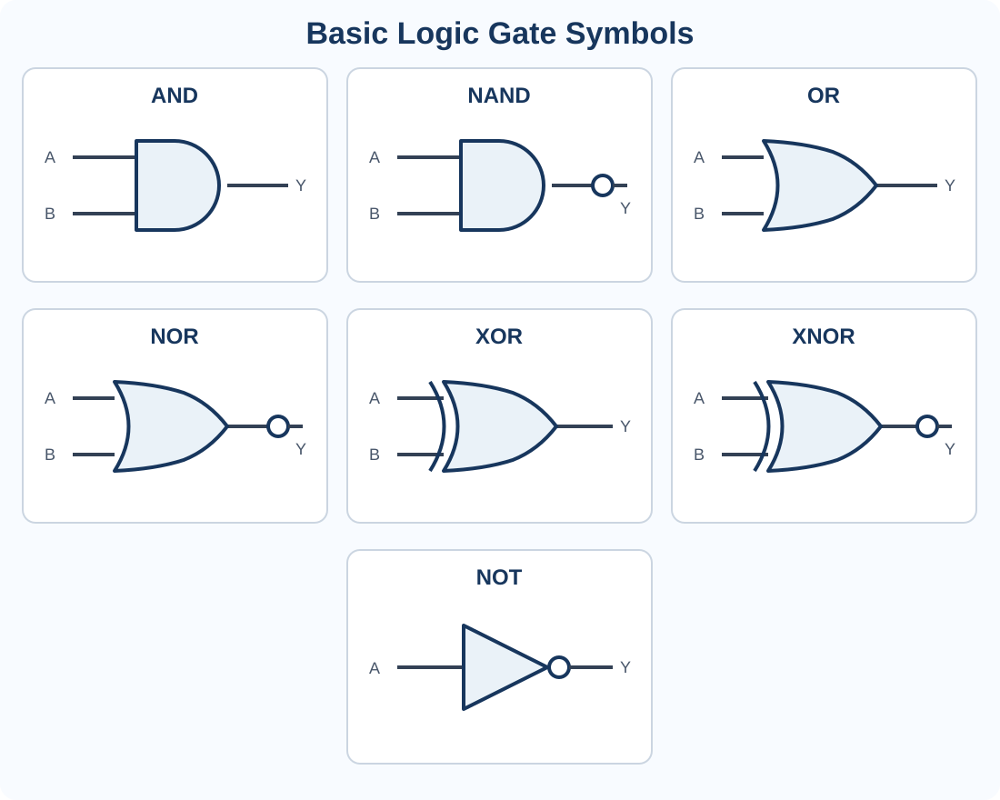
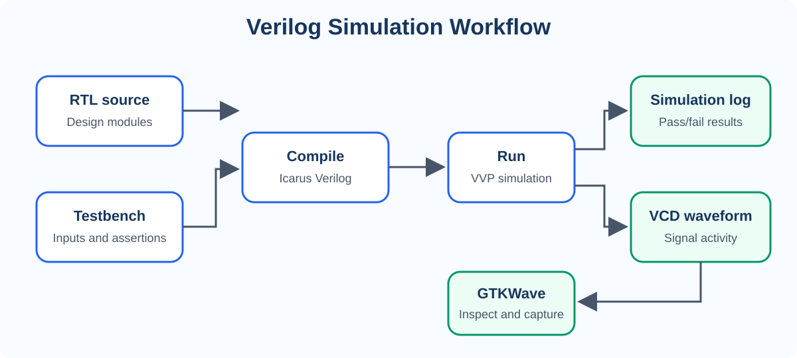

# Diagrams

The diagrams below are embedded as SVG images so they display directly in the GitHub preview.

## RTL block diagram

[Open the RTL diagram source](rtl_block_diagram.svg)

## Basic logic gates

[Open the logic-gate diagram source](basic_logic_gates.svg)

## Simulation workflow

[Open the simulation workflow source](simulation_workflow.svg)
