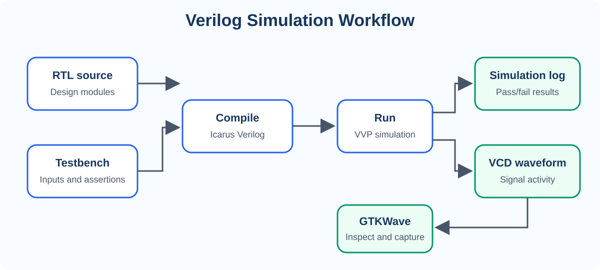

# Simulation workflow

The diagram below shows how the RTL and testbench are compiled, simulated, checked, and inspected.

The self-checking testbench writes the simulation log; the simulator writes the VCD waveform. Open the VCD in GTKWave and save the resulting screenshot for the project evidence.
